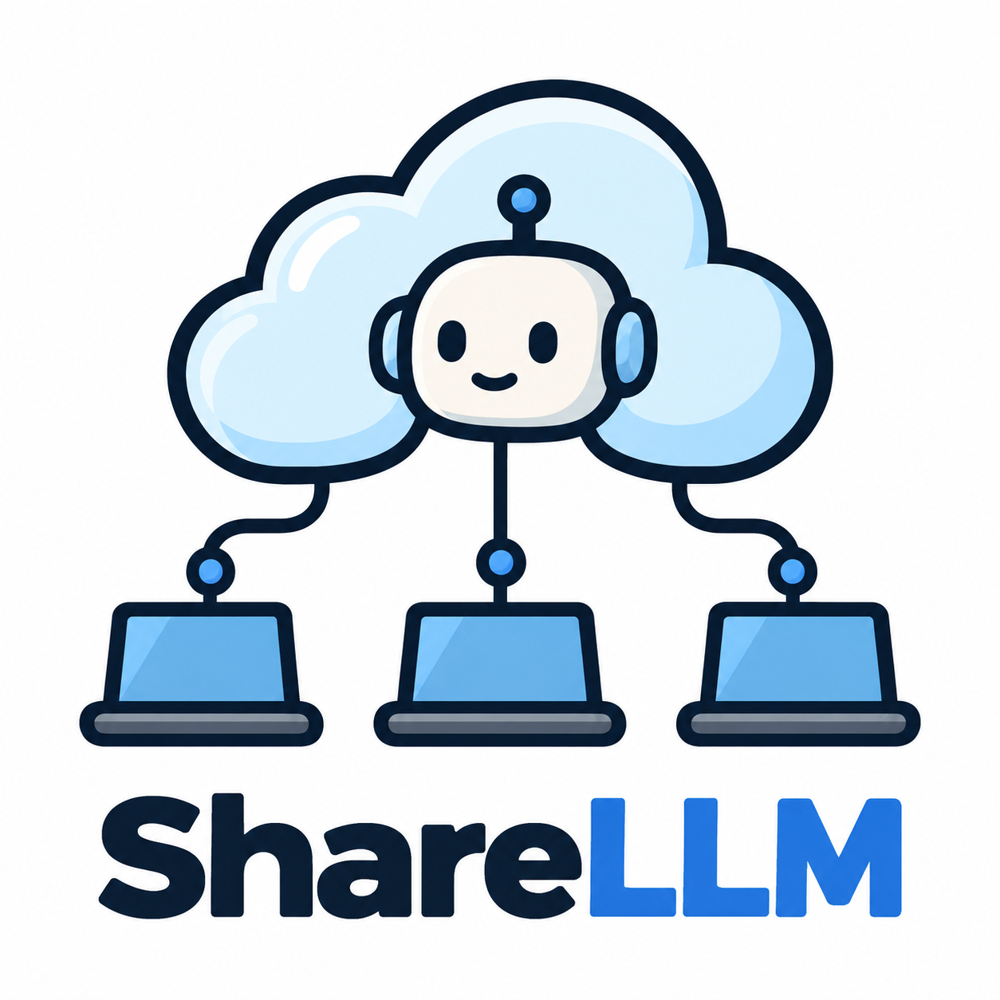

<h1 align="center">
  
</h1>

<p align="center">
  <strong>Share the LLMs running on your team's laptops as one API.</strong>
</p>

<p align="center">
  <a href="LICENSE"></a>
  
  
  
  <a href="CONTRIBUTING.md"></a>
</p>

<p align="center">
  <a href="#quick-start">Quick start</a> ·
  <a href="#documentation">Documentation</a> ·
  <a href="#contributing">Contributing</a> ·
  <a href="SECURITY.md">Security</a>
</p>

---

**ShareLLM Server** turns the [Ollama](https://ollama.com) models on your laptops into a shared,
OpenAI- and Ollama-compatible API. Your agents and tools send requests to the server; laptops
running the ShareLLM client pick up the work, run the model locally and send back the answer.

The laptops only make outgoing connections, so they need no public address, open port or VPN.

## Why ShareLLM?

- 💻 **Use hardware you already have.** Put idle laptop GPUs to work instead of paying for cloud
  inference.
- 🔌 **Works with your tools.** Speaks the OpenAI and Ollama APIs, so LiteLLM, Embabel, Spring AI
  and other clients work unchanged.
- 🔒 **Laptops stay private.** Workers poll the server over HTTPS; nothing connects to them.
- 🛡️ **Reliable.** Jobs are stored in PostgreSQL. When a laptop goes offline, its job moves to
  another laptop automatically.
- 📈 **Scales out.** The server keeps no state of its own, so you can run as many instances as you
  need, on Docker Compose or Kubernetes.
- 🚀 **Production ready.** Ships with HTTPS, Docker secrets, health probes, hardened containers and
  a Kubernetes example.

## How it works

```text
  Agents, LiteLLM,           ShareLLM Server              Laptops with Ollama
  OpenAI/Ollama clients     (+ PostgreSQL queue)          and the ShareLLM client

   ┌───────────┐  request   ┌───────────────┐   poll     ┌───────────┐
   │  caller   │ ─────────► │               │ ◄───────── │  laptop   │
   │           │            │  job queue    │   job      │  Ollama   │
   │           │ ◄───────── │               │ ─────────► │           │
   └───────────┘   answer   └───────────────┘ ◄───────── └───────────┘
                                                result
```

1. A caller sends an inference request, for example to `/v1/chat/completions`.
2. The server queues it as a job.
3. A laptop that has the requested model claims the job, runs it with its local Ollama, and returns
   the result.
4. The server answers the caller, who can also fetch the result later.

Want the details? See the [architecture guide](docs/architecture.md).

## Quick start

You need [Docker](https://docs.docker.com/get-docker/) with Docker Compose.

```bash
git clone https://github.com/OpenJCockpit/ShareLLM-server.git
cd ShareLLM-server
cp .env.example .env
docker compose up --build -d
```

Check that the server is running:

```bash
curl http://localhost:8080/health
# {"status":"UP"}
```

Then connect a laptop: start the **ShareLLM client** with
`SHARELLM_SERVER_URL=http://localhost:8080` and `SHARELLM_WORKER_KEY=dev-worker-key`, next to a
running Ollama with at least one model pulled. Then send your first request:

```bash
curl http://localhost:8080/api/chat \
  -H 'Authorization: Bearer dev-owner-key' \
  -H 'Content-Type: application/json' \
  -d '{"model":"llama3.2:latest","messages":[{"role":"user","content":"Say hello"}],"stream":false}'
```

> [!NOTE]
> The quick start uses development keys and plain HTTP on your own machine. To run ShareLLM for
> your team, follow the [production deployment guide](docs/deployment.md).

## Use it with your tools

Point any OpenAI-compatible client at ShareLLM. For example, in LiteLLM:

```yaml
model_list:
  - model_name: shared-llama
    litellm_params:
      model: openai/llama3.2:latest
      api_base: https://sharellm.example.org/v1
      api_key: os.environ/SHARELLM_PUBLIC_KEY
```

The [integration guide](docs/integrations.md) covers LiteLLM, Embabel, Spring AI and Ollama
clients.

## Documentation

| Guide | What's in it |
|---|---|
| 🧑‍💻 [Local development](docs/development.md) | Running locally, from source, and running the tests |
| 🚀 [Production deployment](docs/deployment.md) | HTTPS with Caddy, secrets, upgrades, backups and troubleshooting |
| 📈 [Scaling and Kubernetes](docs/scaling.md) | Multiple instances, capacity planning and a Kubernetes example |
| 🔌 [Client integrations](docs/integrations.md) | LiteLLM, Embabel, Spring AI and other clients |
| 📖 [API reference](docs/api.md) | Endpoints, async requests and compatibility limits |
| ⚙️ [Configuration](docs/configuration.md) | All settings, with security notes |
| 🏗️ [Architecture](docs/architecture.md) | Job queue, leasing, failure handling and code structure |

## Current limitations

- Responses are delivered in full; there is no token-by-token streaming yet.
- ShareLLM is an inference gateway, not a full Ollama server: model management (pull, delete, …)
  is not available through it.
- All laptops share one worker key, so only install the client on laptops you trust.

See the [API reference](docs/api.md#compatibility-limits) for details.

## Roadmap

- Real token-by-token streaming
- Per-worker credentials and revocation
- Metrics and OpenTelemetry
- Rate limiting and quotas
- Faster job pickup with PostgreSQL `LISTEN/NOTIFY`
- An admin UI

Ideas and feedback are welcome in the
[issue tracker](https://github.com/OpenJCockpit/ShareLLM-server/issues).

## Contributing

Contributions are welcome! Read the [contributing guide](CONTRIBUTING.md) to get started, and
please follow our [code of conduct](CODE_OF_CONDUCT.md).

## Security

Please report vulnerabilities privately, as described in our [security policy](SECURITY.md).

## License

ShareLLM Server is licensed under the [Apache License 2.0](LICENSE). See [NOTICE](NOTICE) for
attribution.
